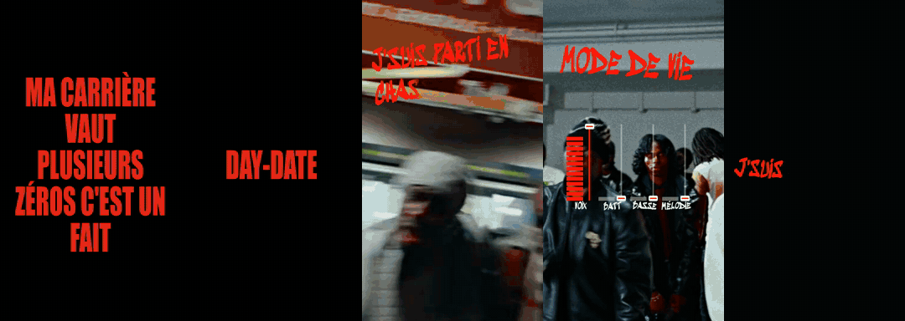

# clip8bit

**Transformer un extrait de clip en vidéo TikTok verticale (1080×1920) stylisée : rétro 8-bit, doodle au feutre rouge, ou vidéo « piste par piste » où l'on voit les stems d'un morceau.**
Tout tourne en local, sans API payante.



*De gauche à droite : carte punchline, 8-bit (palette Game Boy), doodle rouge, piste par piste, doodle sur fond pixellisé.*

## Ce que c'est

Un pipeline en ligne de commande qui part d'une URL YouTube et d'un intervalle de temps, et produit une vidéo prête à publier. Il combine du **traitement d'image et de signal classique** (quantification sur palettes, effets image par image, ffmpeg) et des **modèles d'IA utilisés comme briques**. Ce n'est pas de la génération d'images : aucun modèle ne crée de pixels.

| Brique IA | Rôle |
|---|---|
| Whisper (`mlx-whisper`) | transcription mot à mot, sous-titres calés sur la voix |
| rembg (`u2net_human_seg`) | détourage du personnage, effets par zones |
| demucs (`htdemucs`) | séparation voix / batterie / basse / mélodie |

## Les trois sorties

1. **8-bit** : l'image est réduite sur des palettes 16×16 (brut, noir et blanc, vert Game Boy, couleur vive, mono), avec cartes punchline, viseur « TARGET LOCKED », combo, transitions et sous-titres. Docs : [`docs/RECETTE.md`](docs/RECETTE.md), [`docs/EFFETS.md`](docs/EFFETS.md).
2. **Doodle** : image d'origine en plein cadre, sous-titres écrits au feutre rouge mot à mot, petits dessins, écho sur les mouvements forts, étalonnage renforcé pour la compression TikTok. Docs : [`docs/DOODLE.md`](docs/DOODLE.md).
3. **Piste par piste** : le titre est séparé en stems, des blocs rouges et des curseurs montrent quelle piste joue (variante bass boost incluse). Docs : [`docs/mix/STEMMIX.md`](docs/mix/STEMMIX.md), [`docs/mix/TRANSITIONS.md`](docs/mix/TRANSITIONS.md).

Un format de live en studio est aussi documenté : [`docs/LIVE_STUDIO.md`](docs/LIVE_STUDIO.md).

## Comment ça marche

```
URL YouTube + intervalle
   │  fetch.py          extrait, images 25 i/s, audio
   ├─ Whisper + align2  sous-titres calés mot à mot
   ├─ cuts + prep       scènes, masques (rembg)
   ├─ plan              style de chaque scène (parts visées)
   ├─ quant + compose   palettes, effets (fx.py), habillage
   └─ speed             export 30 i/s, H.264
Piste par piste : demucs → structure.py → stemmix.py
```

Chaque clip est décrit par un petit fichier JSON dans [`exemples/`](exemples/) : style, palette, cartes punchline, effets.

**Zones TikTok.** Tout texte posé par le code reste dans la zone sûre (`scripts/clip2/zones.py`, x 60–910, y 240–1290), sinon le rendu est refusé. Le style doodle refuse aussi tout chevauchement entre éléments.

## Installation

Prérequis : `ffmpeg`, `yt-dlp`, Python 3.12, `rubberband` pour le système mix.
Testé sur macOS Apple Silicon (`mlx-whisper`, demucs sur `mps`).

```bash
# chaîne 8-bit et doodle
python3.12 -m venv work/.venv
work/.venv/bin/pip install numpy opencv-python-headless pillow scipy rembg
uv tool install mlx-whisper

# système mix (stems, piste par piste)
python3.12 -m venv .venv && .venv/bin/pip install -r requirements-mix.txt
```

Toutes les commandes se lancent depuis la racine du dépôt. Exemple, première étape :

```bash
work/.venv/bin/python scripts/clip2/fetch.py "<url YouTube>" 1:50 2:50 work/mon_clip
```

La suite de la chaîne est dans [`docs/RECETTE.md`](docs/RECETTE.md) ; point de départ de config : `exemples/config_modele_vertical.json`.

## Travailler avec un agent de code

Le dépôt est conçu pour être piloté par un agent (Claude Code). [`CLAUDE.md`](CLAUDE.md) donne les règles et les questions à poser avant chaque clip. [`docs/LECONS.md`](docs/LECONS.md) liste les régressions rencontrées et la procédure de non-régression : c'est la mémoire du projet.

## Droits et limites

- Les vidéos, les audios et les paroles ne sont **pas** versionnés (`.gitignore`) : c'est à vous de vérifier que vous avez le droit d'utiliser un extrait. Le GIF ci-dessus ne contient que de très courts extraits à titre de démonstration.
- Les jugements visuels et sonores restent humains : le pipeline contrôle les images exportées, pas l'écoute ni le rythme.
- Projet expérimental, documentation en français.

## Licence

Code sous licence MIT (voir [`LICENSE`](LICENSE)). Les polices de `polices/` et `assets/fonts/` gardent leurs licences d'origine.
